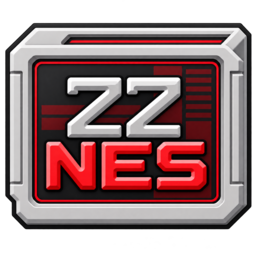
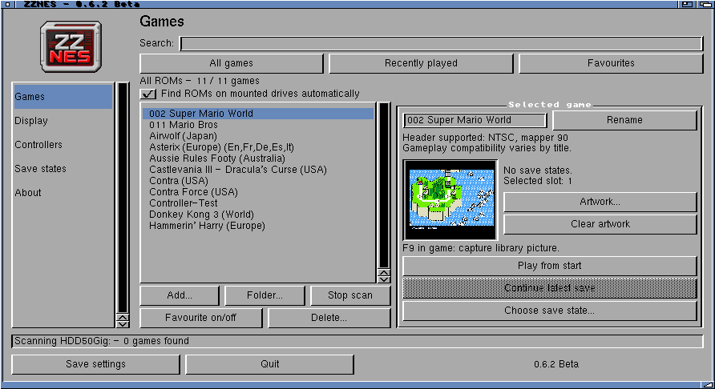
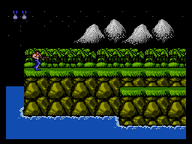
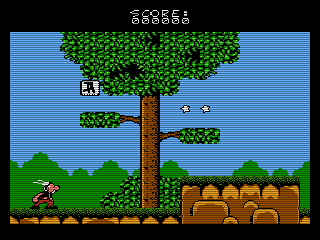
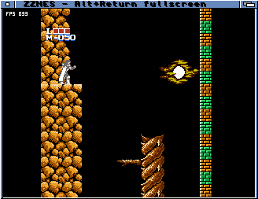
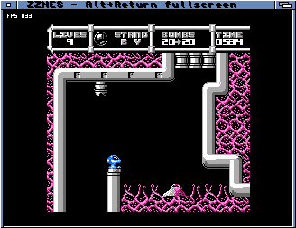
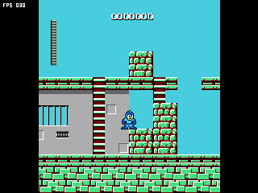
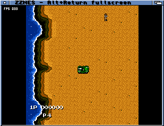
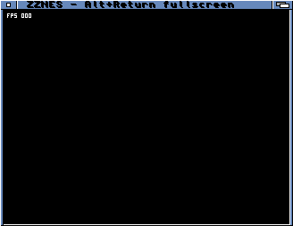

# ZZNES — 0.8.7 Beta

A native **MUI** game library for **AmigaOS and ZZ9000**, using **FCEUX / FCE Ultra**
and **[Xanxi’s XACP platform](https://github.com/Xanxi-Amiga/XACP-ZZ9000)**.
The Cortex-A9 runs emulation and fullscreen rendering; the 68k handles AmigaOS,
files, controls, display coordination and batched AHI audio.

This beta needs **48 MiB of allocatable ZZ9000 RAM**, plus display and AmigaOS memory.

**[Download 0.8.7 Beta — installer or ZIP](https://github.com/SkiltonUSA/ZZNes-ARM-68K/releases/tag/v0.8.7-beta)** ·
[Installation](docs/package-manager.md) · [User guide](docs/current-guide.md) ·
[Changes](CHANGELOG.md) · [Interface gallery](docs/current-interface.md)

**New:** selectable higher-quality Paula audio and 2×/3× windows. [Changes and tests](docs/output-quality.md).

Published app version: **0.8.7-dev**.

**0.8.7 Beta** adds [Native columns](docs/native-columns.md): equal-width NES pixels with side borders for horizontal scrolling.

## Features

- Resizable MUI sidebar with Games, Display, Controllers, Save states, Disks, ROM Manager and About; compact, scrollable layout for 640×480 screens.
- Colour logo, Workbench icon, startup and loading panels with keyboard controls.
- Raw ROMs and single-ROM ZIP archives (stored/deflate), without an external unpacker.
- Search, favourites, history, captured artwork, Add, Rename and confirmed Delete.
- Scan a selected folder, SD card or USB drive once to import ROMs.
- No fixed library-entry cap; tested with 20,000 entries.
- ROM Manager: bulk import, duplicate-entry cleanup with progress/cancel, and verified backups to disk or USB. Duplicate cleanup keeps ROM files and saves.
- Fullscreen or 1×/2×/3× Workbench windows, with **Alt+Return** switching during play.
- **F7** scanline control: Xanxi FPGA effects in fullscreen; Soft software filtering in a window.
- Optional FPS overlay, aspect correction, border artwork, overscan masks and **F9** screenshots.
- Selectable audio: Auto, configured AHI, Paula 14-bit at 22.05/28 kHz, or explicit ZZ9000AX; system preferences stay unchanged.
- Five save-state slots per game, with save, load, resume and delete.
- Joystick testing and live ZZ9000 temperature beside the version.
- Automatic PAL/NTSC timing; mapper 3/Cybernoid and mapper 78/Holy Diver compatibility fixes.

## Specifications

| Component | Specification |
| --- | --- |
| Core | FCEUX / FCE Ultra |
| Emulation processor | ZZ9000 Cortex-A9 / ARMv7-A, application-owned Core1 via XACP |
| Host processor | 68020 instruction set; AmigaOS, files, input, display coordination and AHI |
| Owned ZZ9000 RAM | 48 MiB, including 32 MiB executable reserve; plus display/OS allocations |
| ROM formats | iNES .nes; single-ROM .zip |
| Audio | 32 kHz mono, selectable AHI/Paula/ZZ9000AX output |
| Display | Picasso96 fullscreen or Workbench window; optional scaling, borders and FPS |
| Scanlines | Fullscreen FPGA Classic / Soft / Gradient; windowed ARM Soft |
| Enabled mappers | 0, 1, 2, 3, 4, 5, 78, 90 within the supported iNES contract |

## Requirements

- Zorro III Amiga with **ZZ9000**, configured ZZ9000 Fast RAM and compatible **XACP firmware**. Tested on **XX19c / XACP 1.7**.
- **AmigaOS 3.x**, **MUI 3.8 or compatible**, **Picasso96 API v2+**, **AHI v4+** with an installed output driver and configured unit 0.
- A writable application drawer and your own ROMs; only one Core1 application may run at a time.
- The offline installer also needs **C:lha** and **C:IconX** for Workbench launch.

**A TF4060 or 68060 accelerator is not required.** A faster 68k benefits files,
window updates and audio servicing. The tested system is an A4000TX with
TF4060/68060 and AmigaOS 3.2.3; 68030 performance has not been measured.

## Installation

Choose **`-beta-amipkg.lha`** for the offline installer, or **`-beta.zip`** for
manual copying. Both contain the same matched launcher and player, licences
and scanline tools; neither includes ROMs or Amiga system libraries.

Extract the installer, open its drawer and double-click **Install**. It checks
MUI, Picasso96, AHI and ZZ9000 availability, lets you choose a destination, and
adds missing Xanxi scanline tools. Existing settings, ROMs and saves are preserved.
[Installer details and upgrade limitations](docs/package-manager.md).

## Scanlines

**Soft scanlines and fullscreen are enabled by default.**

Fullscreen uses **[Xanxi’s FPGA scanline interface and tools](https://github.com/Xanxi-Amiga/zz9000-scanlines)**;
a Workbench window uses **our ARM Soft software routine**, shared with ZZDosBox.
The effects do not run together. **F7** cycles Off → Soft → Gradient → Classic
in fullscreen and toggles Off/Soft in a window.

Both downloads bundle **ZZScanlines**, **ZZScanlinesGUI**, **Install-Scanlines**,
source and GPL notices. Existing controls are preserved. **Compatible FPGA
scanline firmware is required**; installing tools does not add firmware support.
The emulator controls the interface directly, so the separate utility need not run.
Hardware scanlines are disabled on normal exit. [Controls and installation](docs/scanline-install.txt).

F9 cannot capture hardware scanlines, which are applied after framebuffer readback.
These earlier gameplay captures show the **software** effect:

| Contra | Asterix |
| --- | --- |
|  |  |

## More games

Captured on the A4000TX/ZZ9000 during compatibility testing.

| Holy Diver | Cybernoid |
| --- | --- |
|  |  |
| **Rockman** | **Jackal** |
|  |  |

## Performance

| Game / emulator | Measured steady emulation FPS |
| --- | ---: |
| Contra — ZZNES | **59.893** |
| Super Mario World — ZZSNES | **59.920** |

Palette byte-order caching, guarded NEON copy/dimming and optional NEON smooth
scrolling reduce presentation work; integer fallbacks remain available.
Earlier repeated 600-frame comparisons measured **12.3% less ARM presentation
time** with scanlines off and **33.8% less** with Soft software scanlines.

These are presentation-stage savings, not equivalent game-FPS gains or new
measurements of this release. [Measurements](docs/current-development.md) ·
[Optimisation work](docs/optimisation-20261018.md).

## Compatibility

Mapper support is bounded: battery-backed cartridges, trainers and NES 2.0 are
not yet enabled. Importing the full FCEUX source does **not** enable every upstream
mapper or desktop tool. [Supported cartridges](docs/cartridge-compatibility-20261019.md) ·
[ROM audit](docs/rom-validation-20261019.md) · [Integration roadmap](docs/fceux-integration.md).

## Credits and source

Development: **Codex assisted, Amiga-Bridge MCP**. Interface: **MUI**.
Thanks to **Xanxi** for XACP and the FPGA scanline tools, and the **FCEUX / FCE Ultra**
contributors for the emulation core. ZIP loading uses Mark Adler’s **puff** from
zlib. The offline installer uses **[amipkg](https://github.com/thomas-luebker/amipkg)**,
with the documented local fixes originally used by ZZDosBox.

FCEUX is GPL-2.0-or-later. Component licences, source pins and notices are included.
[Release build inputs](docs/release-build.json) · [Third-party notices](THIRD_PARTY.md).

## Translation and audio

[Experimental register dispatch](docs/jit-register-experiment.md) removes the
address lookup: 2.38% less core time than the previous translator in a matched
Mario Bros. test. The limited register dispatch is included in this beta; it is not a full guest JIT. Longer-run diagnostics and experimental
audio handoff comparisons are recorded in the report; the earlier freeze remains
unexplained.

[Controlled audio scheduling tests](docs/fixed-presentation.md) found no repeatable gain; release scheduling stays unchanged.

[Fullscreen polling experiment](docs/ack-polling.md) reduces reads of the flip acknowledgement register by about 90%, without a proven FPS gain. Original release polling remains unchanged.

[Pixel-conversion overlap tests](docs/conversion-overlap.md) passed correctness checks but ran slower overall. Existing release scheduling remains the default.

[AHI and bitmap-lock profiling](docs/host-service-profiling.md) led to the per-app AX backend below. Four-frame batching showed no FPS gain; the three-frame default stays.

[Per-app ZZ9000AX audio tests](docs/ax-audio.md) measured **3.2% higher FPS for NES / 4.6% for SNES** in matched short runs. These are experimental, game-specific results. Normal builds follow configured AHI unit 0 so installing an AX driver does not redirect sound.
