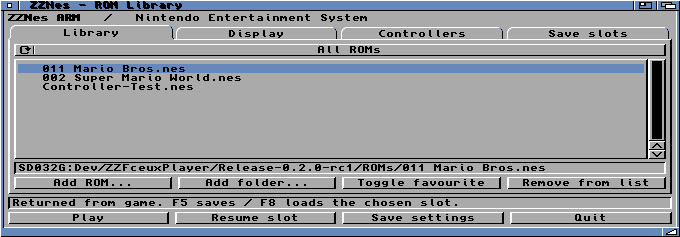
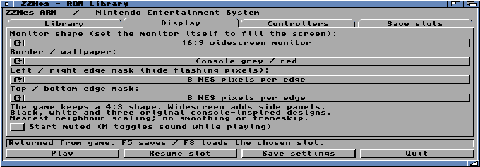
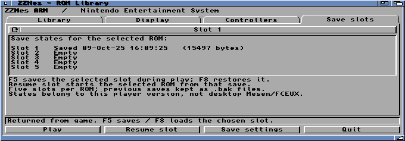
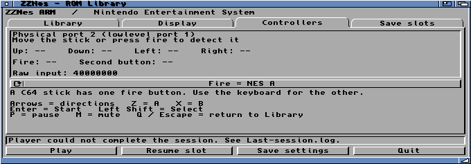
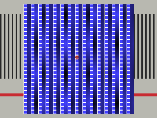

# ZZNes native MUI library — 10 October 2026

Installed separately at `SD032G:Dev/ZZFceuxPlayer/Library-0.3/`.
This is a **0.3.0 development candidate**, not a replacement of the accepted
0.2.0-rc1 release. Launcher MD5 `571d796cb818a426f1b99f48b192f619`;
player MD5 `e056592277459fdf784c1f4c1fefe388`, 293,048 bytes.
Standalone rebuild matches both executables byte for byte.

## Implemented and observed

- Native MUI 3.8 tabs based on xSysInfo's application patterns, credited with
  its BSD notice. ROM file/folder import, 128-entry library, history,
  favourites, mute, fire-button assignment and live joystick test.
- Existing private ROMs remain in their previous drawer; library entries
  point to them. Test favourite was toggled back off. No commercial ROMs or
  snapshots are in this source backup or distribution ZIP.
- 4:3 and widescreen correction; black, white, console-grey/red,
  cream/burgundy and starfield; independent 0/8/16-pixel masks per edge.
- FCEUX CPU/PPU/APU/controller/mapper snapshots, five slots per ROM path,
  saved timestamps and previous-file backups. F5/F8 and cold Resume slot.
  Mesen upstream supports snapshots, but the older extracted Mesen backend
  stripped them; these states belong to the active FCEUX player.
- UI double-click launch, return to Library, favourite filtering and persistence
  observed on the machine. Save, overwrite with .bak, restore, paused
  save/restore and exit all passed. A newly started process resumed the
  physical snapshot; its first, 60th and 120th frame cycle/pixel hashes match
  the native core loaded from that same snapshot.
- Original-controller fixture sessions: 2,280 frames with save/load/overwrite;
  1,080-frame cold resume; final renderer 1,173-frame session with paused
  save/load. All ended with clean RET1, original MMU/register/cache values,
  zero witness mismatches, no pending flips, completed PCM and released memory.
- Native replay at four points on original NROM, Mario Bros and mapper90 SMW
  reproduces 120 subsequent frames' pixels, cycles and PCM, also across fresh
  processes. Bad ROM/version/checksum/truncated states do not mutate the core.
- Actual A9 instruction model tests state replay and both display formats,
  themes, masks, challenge failures, guards, cancellation and mapping removal.
  This model does not prove physical cache behaviour; live tests cover that.
- `make test-amiga-arm test-amiga`, native/ASan tests, four original cartridge
  layouts, library model round-trip and standalone checks passed. AHI worker
  tests cover the new drain/resume transaction, including request links.

Joystick movement/fire and the final picture/sound remain owner acceptance
items. The owner chose to test the joystick later. An idle read returned
`40000000` (unknown), not proof of a detected or faulty joystick. No forced
port type or mouse-port changes were made.

## Timing scope

Final renderer, 300-frame Mario startup, 4:3/no scripted input: **47.74 FPS**
including first-frame readback and audio drain, 2.266 ms mean ARM presentation,
six sampled native hashes/cycles, all 159,725 PCM samples completed. This is a
short feature-validation run, not a controlled comparison or a 60 FPS claim.
The new scaling/border work costs more than the prior unscaled 256-pixel copy.

An earlier 300-frame **VERIFY** run read back six full 320-pixel framebuffers
and achieved 26.25 FPS; it is a deliberately intrusive diagnostic, not ordinary
playback performance. Earlier interactive save/load sessions include file I/O,
pauses and screenshot capture and must not be used as comparable benchmarks.

## Issues found and fixed during development

1. `PROGDIR:` in a child shell did not resolve to the MUI app directory.
   Launch commands now use bounded, quoted absolute paths from GetProgramDir.
2. AHI's completion counter advances when requests are reaped, not merely when
   playback finishes. The initial save drain timed out and exited cleanly.
   The new drain handshake reaps both completed requests and resumes with
   no stale link. The failed run is retained in `first-hardware-failure.log`.
3. Generic per-pixel division made the first scaled renderer expensive.
   Constant ratios and a cached horizontal sample map removed that repeated
   calculation; the final ARM image is 122,136 bytes. No cache contract changed.

## Screenshots

The fullscreen capture below is the **raw 320×240 bitmap**, before the monitor
stretches it. It uses the original test cartridge and console-grey theme;
on a widescreen monitor the central logical area becomes 4:3.

The requested Mesen-S discussion images are embedded with their original
attribution in [the overscan guide](../../../fceux_player/overscan.md).
They are SNES screenshots, not standalone NES bezel assets.
