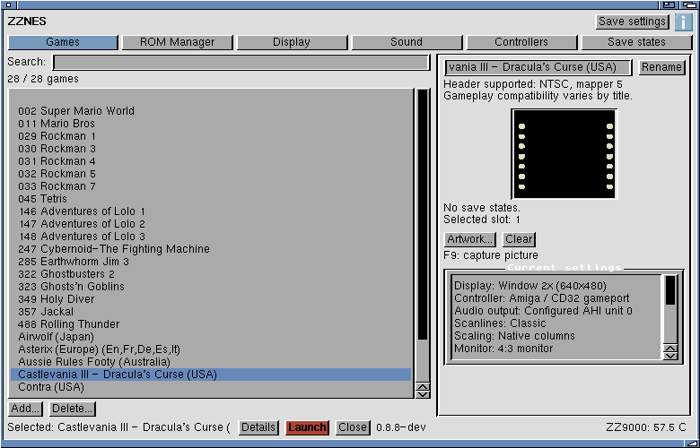

# ZZ8-Bit launcher styling — 11 November 2026

- Six compact top tabs; supplied **[i] About** bitmap beside Save settings.
- Light grey panels, blue active tab and red Launch button.
- Search above the game list; narrow preview/settings panel at the right.
- Default width reduced to 780 pixels; Games has no outer bottom/right scrollbars.
  ROM-list scrolling and scrollable longer settings pages remain available.
- Current-action footer and expandable Details history, bounded to 200 entries.
- Helvetica 13 with Topaz 8 fallback; compact screens use Topaz 8.

Build and native layout checks pass. Physical MUI checks pass for all seven
pages, a 640×480 screen budget, 480/608/768×360 window resizing, audio/display
selectors, settings summary and Details expansion/collapse. The Workbench
screen mode was not changed. Details tests verify the actual page height;
this MUI installation reports ShowMe=1 even after the panel is hidden.
Group changes bracket visibility updates using InitChange/ExitChange.

The launcher was installed with a rollback copy. Player and settings checksums
were unchanged. This is a UI update, not a new gameplay/performance result.
Published packages have not been replaced.

