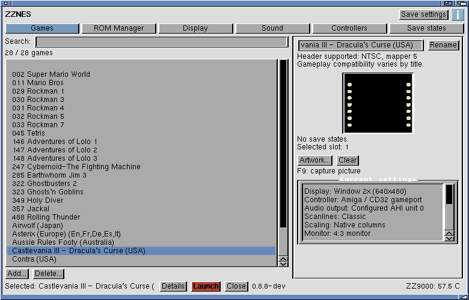

# Compact launcher

Development launcher update, 11 November 2026. Published packages are unchanged.

- Top tabs: Games, ROM Manager, Display, Sound, Controllers and Save states.
- The **[i] About** icon sits beside Save settings, matching ZZ8-Bit.
- ZZ8-Bit styling: light grey panels, blue active tab, compact red Launch button.
- Helvetica 13 on larger screens; Topaz 8 for compact screens or as a fallback.
  Fixed-width activity text; no global font changes.
- Up to 780 pixels wide, bounded by Workbench; compact layout at 640×480.
- Two rows of tabs on compact screens. Pages and long game/settings lists remain scrollable.
- Game preview and current settings sit in a narrow right-hand panel.
- Games has no outer bottom/right scrollbars; the ROM list keeps its own scrollbar.
  Longer settings pages remain scrollable on small screens.
- Search directly above the game list. Header logo and history/favourite filters removed.
  Stored favourite/history metadata remains intact.
- Sound controls move out of Display; ROM import/scan stays in ROM Manager.
- Save-state resume actions live on Save states. Games shows Current settings instead.
- Current settings reads the launch controls, including window size, controller,
  audio output, filters and masks; it updates after edits and SNES profile changes.
  These are configured choices, not live device detection.
- Footer shows the current action; Details expands a 200-entry RAM-only activity history.
  No background log-file writes or ROM scans.

## Controllers

NES controller choices label the existing AmigaOS/CD32-compatible input routes.
CD32 USB requires Poseidon HID joystick mapping; Sega requires a compatible
gameport/CD32 adapter. This UI update does not introduce a direct Sega six-button
protocol or raw USB driver into the NES player.

## Build and verification

The overlays are `scripts/prepare_compact_ui.py` and `scripts/prepare_console_style.py`, shared by launcher-only and full
build preparation. Editable helpers are in `development/compact-ui-20261030`.
Both use MUI 3.8 built-ins, with no extra custom classes to install.
The build uses ImageMagick (`magick`) to pack the supplied ZZ8-Bit About icon
into the executable; no image file or datatype dependency is added on the Amiga.

Build ZZNES with `python3 scripts/build_launcher.py`; build ZZSNES with
`python3 scripts/build_launcher.py --expanded`. Use `--probe 640x480` for the
isolated read-only layout check. The probe covers seven pages, resizing,
audio/display selectors, settings summary and bounded activity history.

Core/player binaries, saved settings and ROMs are not altered by this UI update.

[Hardware and native checks](../amiga/records/2026-10-30/compact-ui/README.md).

[ZZ8-Bit styling checks](../amiga/records/2026-11-11/zz8-interface/README.md).

