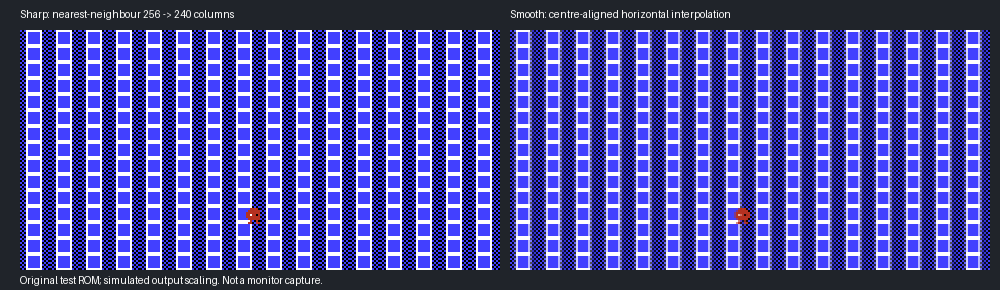

# ARM, scrolling and library optimisation — 0.7.2-dev

An opt-in development candidate; existing release downloads and default release
rebuilds are unchanged. Measurements use an A4000TX/68060, ZZ9000,
XX19c/XACP 1.7 and AHI. They do not establish slower-68k performance.

## Vertical columns during scrolling

The controlled test generates an original cartridge whose NMI advances the
horizontal PPU offset through all eight fine-scroll phases. The pinned core
produces 69 correct one-pixel transitions and ten phase wraps in **both NTSC
and PAL**. That excludes a coarse-only scroll in this fixture; it does not
exclude a mapper or game-specific rendering bug in an unidentified title.

The existing presentation scales 256 source pixels to either 320 or 240 output
pixels, depending on monitor aspect. Nearest-neighbour scaling necessarily
repeats or drops columns at these ratios. High-contrast patterns moving through
the scale grid can therefore show periodic thick/thin columns even when the
underlying PPU scroll is correct. Masks hide overscan edges but do not repair
this scaling pattern.

**Display → Pixel scaling** now offers:

- **Sharp pixels:** existing nearest-neighbour scaling and hard pixel edges.
- **Smooth scrolling:** centre-aligned horizontal linear interpolation with
  integer weights. It softens transitions between columns, at some ARM cost.

Vertical scaling, aspect correction, borders, masks and game timing retain
their behaviour. Filtering clamps at overscan boundaries to prevent hidden
pixels bleeding into the picture. It is compatible with software scanlines
and the FPS overlay in windows and fullscreen.



[Animated original diagnostic](screenshots/scroll-scaling.gif). These are
simulated presentation comparisons made from the original test cartridge,
not recordings of a commercial game or the Amiga monitor. The user's specific
scrolling report still requires a visual comparison with the affected game.

## Techniques carried across from ZZDosBox

- Cache the native-endian palette, removing repeated byte-order conversion
  from the pixel loop.
- Precompute scaling indices and weights when view options change.
- Use guarded NEON integer interpolation, preserving exact scalar output and
  a scalar fallback. The existing complete SIMD/FPSCR restoration remains.
- Cache display titles while sorting; batch metadata hex writes and replace
  per-record formatted scans with bounded token parsing.
- Compare exact pixels and state before interpreting timing. Direct ARM
  framebuffer output, overlapped flips and batched AHI already existed; this
  pass does not claim them as new gains.

No x86 JIT, TinyGL matrix or VFP scheduling code is imported: those DOSBox
techniques do not directly speed up this NES interpreter.

## Measurements

See the [raw logs and computed summaries](../amiga/records/2026-10-18/optimisation/).
Presentation values use `DIRECT_END copy_us / challenges`; they are not game
FPS. Tests use the first 600 frames after reset, unless explicitly identified
as gameplay. The initial readback and automatic snapshot affect whole-run
elapsed time and audio-gap counts.

The initial palette-only comparison measured 4.24% less presentation time with
scanlines Off and 4.19% less with Soft, at its selected 16:9/mask settings.
These early NES runs polled the bridge during playback, so they are **not**
frame-pacing or audio-jitter evidence. Later comparisons use quiet playback
and the installed aspect/border settings. Smoothing is a visual-quality option,
not a claim of increased FPS.

Final sharp/smooth comparisons at the installed 16:9/border/mask settings:

| Presentation variant | Median µs per presented frame |
| --- | ---: |
| Previous sharp scaling | 2139.23 |
| Candidate sharp scaling | 2123.29 |
| Initial scalar smoothing | 4395.06 |
| First NEON smoothing (staged pairs) | 3736.01 |
| Final NEON smoothing (row conversion + table lookup) | 2716.16 |

The final filter uses NEON `vtbl` to select neighbouring colours from eight-pixel
source spans. Each source pixel is palette-converted once per row; weights and
byte selection tables are prepared when the view changes. It retains exact
rounding, bounded source padding and scalar tails.

This reduces smoothing-stage time by **38.2% versus the initial scalar filter**,
but still costs about **0.59 ms more per presented frame than sharp scaling**.
The final sharp-mode saving at these settings is only **0.7%**. These numbers
must not be represented as equivalent increases in emulated FPS. Baseline and
first-NEON timings use three quiet runs, scalar two, final smoothing three, and
final sharp two. The repeated first-NEON/final-filter series interleaves order.

### Audio priming

With identical final ARM code and a pre-existing snapshot (so automatic capture
does not stall the timing run), three order-interleaved 600-frame comparisons
recorded:

| NES audio prebuffer | Gap counter, three runs | PCM delivery |
| --- | --- | --- |
| Previous: 3 frames | 9, 5, 14 | All 319,449 samples completed per run |
| Selected: 4 frames | 0, 0, 0 | All 319,449 samples completed per run |
| Alternative: 6 frames | 0, 0, 0 | All 319,449 samples completed per run |

The candidate uses **four frames**: one frame of scheduling margin beyond the
three-frame AHI transfer batch. No resampling, sample dropping, sample-rate
change or global AHI preference change. Nominal initial buffering increases by
one emulated frame (about 17 ms NTSC or 20 ms PAL); end-to-end audiovisual latency
was not measured. Pause/state/quit still force-flush partial batches.

This counter detects a linked request already finished before its successor
is submitted. Zero events in these runs is useful evidence, not a guarantee
of inaudible playback under all workloads. Earlier tests with automatic
snapshots/readbacks recorded stalls and remain in the evidence; they are not
silently discarded.


## Large libraries

A real-68k helper with 20,000 synthetic entries measured these two-run medians:

| Operation | Previous | Candidate | Less time |
| --- | ---: | ---: | ---: |
| Sort | 16.73 s | 4.28 s | 74.4% |
| Write metadata | 11.70 s | 2.23 s | 80.9% |
| Read metadata | 11.20 s | 9.27 s | 17.2% |

These are metadata operations, not total MUI opening time or game tests. The
sort cache uses 128 bytes per entry temporarily (2.56 MB for 20,000) and is
freed afterwards; allocation failure uses the original comparator. Library
size remains limited by available memory, with no configured ROM-count cap.

## Validation and reproduction

- ASan/UBSan: 1,658,880 sampled presentation pixels across sharp/smooth options,
  byte orders, masks, borders and guard regions. Library tests cover 20,000
  entries, legacy settings, numeric overflow, malformed records and allocation
  failures. Fine-scroll core tests use ASan and selected UBSan checks; upstream
  biased-pointer code is excluded from array/pointer-overflow instrumentation.
- Relocated A9 model: independent per-channel colour oracle, all scanline modes,
  scalar/NEON availability, all interpolation weights, partial vector lengths,
  guard bytes and callee-saved SIMD registers. Full presenter checks preserve
  all D registers/FPSCR and revoke framebuffer mappings.
- Physical active-frame readbacks check fullscreen/window output, scanlines,
  FPS overlay and clean ownership release. Diagnostic readback stalls playback
  deliberately; those runs are correctness evidence, not speed measurements.

```sh
make optimisation
make test-optimisation-native
make test-scrolling
make test-optimisation-arm MODEL_PYTHON=/path/to/unicorn-python
```

Set `LLVM_NM` if llvm-nm is not on PATH. Toolchain requirements remain those in
[current development](current-development.md). Outputs are in
`.context/optimisation-build`. Builds do not deploy or contact hardware.

The new setting writes **ZZNESUI4** preferences. Older v1/v2/v3 files load with
Sharp selected. Back up Library.cfg before trying this candidate and restore
it with older executables when rolling back; older launchers cannot read v4.
Game save-state formats and identities are unchanged. No mapper compatibility
expansion is claimed. Device paths in public logs are replaced with `TEST:`;
ROMs, private settings and saves are excluded.

## Interactive checks and recorded failures

Final hardware checks passed pause, save/load, manual snapshot, window/fullscreen
switching and F10 exit. A fresh process then resumed each saved state for 120
frames. NES one- and three-frame runs also completed every queued PCM sample,
exercising shutdown before the new four-frame prebuffer is filled.

An initial SNES interactive attempt exited with code 20 after 14 frames and
pending AHI data; processor restoration and memory release still succeeded.
Quiet window tests (baseline and candidate, FPS on/off) and the later focused,
fully-started interactive test passed. The isolated early failure is retained
in `snes-lifecycle.log` in the SNES evidence; no production fix or definitive
root cause is claimed for it. Hardware tests therefore do not establish that
all startup/audio stalls have been eliminated.

A separate NES test-harness assertion was false: AmigaDOS would not open the
still-redirected log because it was in use. Reading the log after exit confirmed
that save and cleanup had succeeded. The harness now checks the completed state
file instead, and waits for playback before injecting controls. These test
harness corrections do not change the emulator's state format or core.
